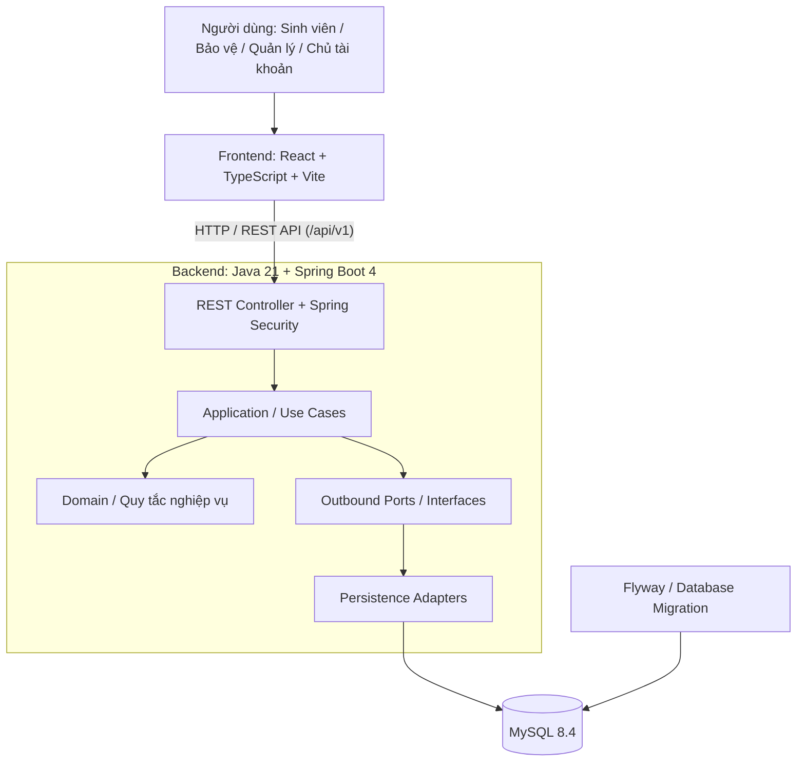

# HỆ THỐNG THANH TOÁN PHÍ GỬI XE BẰNG ĐIỂM

**Bài tập lớn môn Lập trình hướng đối tượng (OOP)**  
**Mã nguồn:** [Halinh2726/BTL_OOP](https://github.com/Halinh2726/BTL_OOP)

Dự án xây dựng một hệ thống quản lý gửi xe và thanh toán phí bằng **điểm điện tử**. Sinh viên đổi tiền mặt thành điểm, sử dụng điểm để thanh toán khi lấy xe; số điểm thu được chuyển vào ví của chủ tài khoản bãi xe. Hệ thống cung cấp giao diện web cho từng vai trò, API xử lý nghiệp vụ và cơ sở dữ liệu lưu trữ giao dịch.

## 1. Tổng quan về bài tập lớn

### 1.1. Bài toán đặt ra

Việc thu phí gửi xe bằng tiền mặt có thể gây bất tiện trong khâu thanh toán, đối soát và theo dõi giao dịch. Bài tập lớn mô phỏng một phương thức thu phí tập trung, trong đó mỗi sinh viên có ví điểm và quá trình thanh toán được thực hiện tự động khi bảo vệ xác nhận xe ra khỏi bãi.

**Quy trình nghiệp vụ chính:**

1. Sinh viên đăng ký tài khoản và phương tiện.
2. Quản lý tiếp nhận tiền mặt và quy đổi thành điểm trong ví sinh viên.
3. Bảo vệ tra cứu biển số và xác nhận xe vào bãi.
4. Khi xe ra, bảo vệ kiểm tra thông tin và xác nhận; hệ thống tính phí, trừ điểm của sinh viên và cộng điểm cho chủ tài khoản.
5. Chủ tài khoản xem số dư, lịch sử nhận phí và thực hiện rút điểm ra tiền mặt thông qua quản lý.

### 1.2. Các vai trò trong hệ thống

| Vai trò | Chức năng chính |
|---|---|
| **Sinh viên** | Đăng ký tài khoản, đăng ký xe, theo dõi số dư điểm và lịch sử giao dịch. |
| **Bảo vệ** | Tra cứu biển số, xem trước kết quả kiểm tra, xác nhận xe vào và xe ra. |
| **Quản lý** | Đổi tiền mặt sang điểm, xử lý rút điểm, tạo và khóa/mở khóa tài khoản bảo vệ. |
| **Chủ tài khoản** | Theo dõi số điểm nhận từ phí gửi xe, xem lịch sử giao dịch và yêu cầu rút điểm. |

**Quy tắc demo hiện tại:** 1 đồng = 1 điểm; phí gửi xe là **3.000 điểm** nếu xe ra trước 18:00 và **5.000 điểm** nếu xe ra từ 18:00 (giờ Việt Nam). Các mức phí và tỷ lệ quy đổi được quản lý trong dữ liệu cấu hình của hệ thống.

## 2. Mục tiêu của dự án

- **Về nghiệp vụ:** Xây dựng quy trình gửi xe, thanh toán bằng điểm, quản lý ví và ghi nhận giao dịch rõ ràng, nhất quán.
- **Về lập trình hướng đối tượng:** Vận dụng bốn đặc trưng OOP là **đóng gói, kế thừa, đa hình và trừu tượng hóa** để tổ chức các đối tượng và quy tắc nghiệp vụ.
- **Về kiến trúc phần mềm:** Phân tách giao diện, xử lý nghiệp vụ và truy cập dữ liệu; tổ chức backend theo module và các lớp của Clean Architecture (Ports & Adapters).
- **Về cơ sở dữ liệu:** Thiết kế dữ liệu quan hệ, bảo đảm tính toàn vẹn, hạn chế giao dịch trùng và hỗ trợ kiểm tra lịch sử thu/chi điểm.
- **Về kiểm thử và bảo mật:** Kiểm soát quyền truy cập theo vai trò, xử lý phiên đăng nhập, bảo vệ các API ghi dữ liệu và kiểm thử các luồng nghiệp vụ quan trọng.

### 2.1. Các đặc trưng OOP được áp dụng

| Đặc trưng | Ví dụ trong hệ thống |
|---|---|
| **Đóng gói (Encapsulation)** | `Wallet` quản lý số dư và thay đổi số dư thông qua các phương thức nghiệp vụ như `credit()` và `debit()`. |
| **Kế thừa (Inheritance)** | Lớp trừu tượng `User` được chuyên biệt hóa thành `Student`, `Guard`, `Manager`, `Owner`. |
| **Đa hình (Polymorphism)** | Các loại giao dịch `CashDeposit`, `ParkingPayment`, `CashWithdrawal` được biểu diễn thông qua kiểu cơ sở `PointTransaction`. |
| **Trừu tượng hóa (Abstraction)** | `FeePolicy` quy định giao diện tính phí, còn `TimeSlotFeePolicy` triển khai cách tính phí theo khung giờ; các `port` che giấu chi tiết lưu trữ. |

## 3. Kiến trúc hệ thống

### 3.1. Kiến trúc tổng thể

Hệ thống sử dụng mô hình **frontend–backend–database**. Backend được tổ chức theo kiểu **Modular Monolith**: các chức năng nghiệp vụ nằm trong những module riêng nhưng được triển khai trong cùng một ứng dụng Spring Boot.



**Vai trò của từng lớp:**

| Thành phần | Trách nhiệm |
|---|---|
| **Frontend** | Hiển thị màn hình theo vai trò, tiếp nhận thao tác và gọi API. |
| **REST Controller** | Nhận yêu cầu HTTP, kiểm tra dữ liệu đầu vào và trả kết quả. |
| **Application / Use Case** | Điều phối từng luồng nghiệp vụ và giao dịch. |
| **Domain** | Biểu diễn đối tượng, trạng thái và các quy tắc nghiệp vụ bằng Java. |
| **Port / Adapter** | Phân tách hợp đồng truy cập dữ liệu khỏi cách triển khai bằng JDBC/JPA. |
| **MySQL + Flyway** | Lưu trữ dữ liệu và quản lý phiên bản cấu trúc cơ sở dữ liệu. |

### 3.2. Các module nghiệp vụ ở backend

Mã nguồn backend được đặt tại `backend/src/main/java/com/ptit/parking/`.

| Module | Trách nhiệm |
|---|---|
| `auth` | Đăng nhập, quản lý phiên, người dùng và vai trò. |
| `student` | Đăng ký sinh viên, đăng ký phương tiện. |
| `catalog` | Quản lý danh mục loại xe, bảng phí và tỷ lệ quy đổi. |
| `parking` | Quản lý lượt gửi, xác nhận xe vào/ra và tính phí. |
| `payment` | Quản lý ví điểm, giao dịch và cơ chế tránh xử lý trùng. |
| `manager` | Đổi điểm, rút điểm và quản lý tài khoản bảo vệ. |
| `shared` | Các thành phần dùng chung: bảo mật, lỗi, giới hạn tần suất, transaction. |

Trong từng module, mã nguồn được phân chia theo hướng:

```text
<module>/
├── domain/                    # Entity, value object và quy tắc nghiệp vụ
├── application/
│   ├── usecase/               # Điều phối nghiệp vụ
│   └── port/out/              # Interface truy cập dịch vụ / dữ liệu ngoài
├── adapter/
│   ├── in/web/                # REST controller, request/response DTO
│   └── out/persistence/       # Triển khai lưu trữ bằng JDBC / JPA
└── config/                    # Cấu hình và lắp ráp thành phần Spring
```

## 4. Cấu trúc thư mục

Các thư mục chính của repository:

```text
BTL_OOP/
├── backend/                               # Java Spring Boot
│   ├── mvnw, mvnw.cmd                     # Maven Wrapper
│   └── src/
│       ├── main/
│       │   ├── java/com/ptit/parking/     # Các module nghiệp vụ
│       │   │   ├── auth/
│       │   │   ├── student/
│       │   │   ├── catalog/
│       │   │   ├── parking/
│       │   │   ├── payment/
│       │   │   ├── manager/
│       │   │   └── shared/
│       │   └── resources/db/migration/    # Flyway SQL migrations
│       └── test/                          # Unit và integration tests
├── frontend/                              # React + TypeScript + Vite
│   ├── src/
│   │   ├── app/                          # Router, providers, layout
│   │   ├── features/                     # auth, student, guard, manager, owner
│   │   └── shared/                       # API client, UI components, hooks, types
│   ├── public/                           # Tài nguyên tĩnh
│   └── README.md                         # Tài liệu riêng cho frontend
├── docs/
│   ├── database/ERD.md                   # Thiết kế cơ sở dữ liệu
│   └── postman/
│       └── parking-payment.postman_collection.json
├── .env.example                          # Mẫu biến môi trường
└── README.md                             # Tài liệu tổng quan dự án
```

Ngoài các thư mục trên, thư mục gốc có cấu hình **Docker Compose** để khởi chạy MySQL phục vụ phát triển và demo.

## 5. Công nghệ sử dụng

| Nhóm | Công nghệ | Mục đích |
|---|---|---|
| **Ngôn ngữ backend** | Java 21 | Hiện thực các lớp đối tượng và quy tắc nghiệp vụ. |
| **Backend framework** | Spring Boot 4 | Xây dựng REST API và ứng dụng máy chủ. |
| **Bảo mật** | Spring Security | Xác thực phiên, phân quyền theo vai trò và bảo vệ CSRF. |
| **Frontend** | React 18, TypeScript, Vite | Xây dựng giao diện web theo vai trò. |
| **Giao diện / trạng thái** | Tailwind CSS, TanStack Query | Xây dựng UI và quản lý dữ liệu lấy từ API. |
| **Cơ sở dữ liệu** | MySQL 8.4 | Lưu tài khoản, phương tiện, lượt gửi, ví và giao dịch. |
| **Quản lý schema** | Flyway | Tạo và cập nhật cấu trúc CSDL theo phiên bản. |
| **Môi trường chạy CSDL** | Docker Compose | Khởi chạy MySQL nhất quán giữa các máy. |
| **Build backend** | Maven Wrapper | Chạy và kiểm thử backend mà không cần cài Maven riêng. |
| **Kiểm thử** | JUnit 5, Mockito, AssertJ, Testcontainers, Vitest | Kiểm thử đơn vị, tích hợp và frontend. |
| **Kiểm thử API** | Postman, Newman | Chạy kịch bản kiểm thử luồng nghiệp vụ. |

## 6. Hướng dẫn cài đặt và chạy

### 6.1. Yêu cầu môi trường

- **JDK 21** trở lên.
- **Node.js 20** trở lên và npm (để chạy frontend).
- **Docker** và **Docker Compose** (Docker Desktop trên Windows hoặc Docker Engine trên Linux).
- **Git** (để sao chép mã nguồn).

> Không cần cài đặt MySQL hoặc Maven riêng. MySQL chạy trong Docker và backend sử dụng Maven Wrapper.

### 6.2. Tải mã nguồn

```bash
git clone https://github.com/Halinh2726/BTL_OOP.git
cd BTL_OOP
```

### 6.3. Khởi chạy MySQL

Tại **thư mục gốc** của dự án:

```bash
docker compose up -d
```

Thiết lập mặc định của môi trường demo:

| Thành phần | Giá trị |
|---|---|
| Database | `parking` |
| MySQL user | `parking` |
| MySQL password | `parking` |
| MySQL port | `3306` |
| Backend port | `8080` |
| Frontend port | `5173` |

Nếu cần thay đổi cấu hình, sao chép `.env.example` thành `.env`, chỉnh các thông số Docker Compose và thiết lập các biến môi trường tương ứng cho backend.

### 6.4. Chạy backend

Mở terminal ở thư mục gốc dự án, sau đó:

**Windows (PowerShell / CMD):**

```powershell
cd backend
.\mvnw.cmd spring-boot:run
```

**Linux / macOS:**

```bash
cd backend
./mvnw spring-boot:run
```

Khi ứng dụng khởi động thành công, Flyway tự áp dụng các migration và tạo dữ liệu mẫu. Kiểm tra tại:

```text
http://localhost:8080/api/v1/health
```

Kết quả mong đợi:

```json
{"status":"UP","database":"UP"}
```

### 6.5. Chạy frontend

Mở **terminal khác** tại thư mục gốc `BTL_OOP/` (giữ backend đang chạy):

```bash
cd frontend
npm install
npm run dev
```

Truy cập giao diện tại **http://localhost:5173**.

Có thể chạy chế độ dữ liệu mô phỏng để xem giao diện **mà không cần backend và MySQL**:

```bash
npm run dev:mock
```

### 6.6. Tài khoản demo

| Vai trò | Tên đăng nhập | Mật khẩu | Cách tạo |
|---|---|---|---|
| Quản lý | `quanly01` | `Quanly@123` | Có sẵn khi khởi tạo CSDL. |
| Chủ tài khoản | `chutk01` | `Chutk@123` | Có sẵn khi khởi tạo CSDL. |
| Sinh viên | Tự chọn | Tự đặt | Đăng ký tại giao diện `/register`. |
| Bảo vệ | Do quản lý cấp | Do quản lý cấp | Quản lý tạo trong chức năng quản lý bảo vệ. |

> **Lưu ý:** Đây là tài khoản và mật khẩu **chỉ dành cho môi trường demo**. Không sử dụng các thông tin mặc định này khi triển khai thực tế.

### 6.7. Kiểm thử dự án

**Backend:**

```bash
cd backend
# Windows:
.\mvnw.cmd test
# Linux/macOS: ./mvnw test
```

Các bài kiểm thử tích hợp sử dụng **Testcontainers** cần Docker hoạt động; nếu không có Docker, một số kiểm thử tích hợp có thể được bỏ qua.

**Frontend:**

```bash
cd frontend
npm test
npm run typecheck
npm run build
```

**Chạy kịch bản API bằng Newman** (từ thư mục gốc, cần Node.js):

```bash
npx newman run docs/postman/parking-payment.postman_collection.json
```

> Collection Postman ghi dữ liệu vào CSDL thật, vì vậy chỉ chạy trên môi trường phát triển hoặc demo.

### 6.8. Một số lưu ý khi vận hành

- API có đường dẫn gốc `http://localhost:8080/api/v1`.
- Backend sử dụng **cookie phiên (`SESSION`)** và cơ chế **CSRF**, không sử dụng JWT.
- Các nghiệp vụ đổi điểm, rút điểm và xác nhận xe ra yêu cầu `Idempotency-Key` để tránh xử lý một giao dịch nhiều lần.
- Nếu cổng `3306` bị chiếm, cần dừng dịch vụ MySQL khác hoặc thay đổi cổng theo cấu hình môi trường.
- Để **xóa toàn bộ dữ liệu demo** và khởi tạo lại từ đầu, chạy tại thư mục gốc:

```bash
docker compose down -v
docker compose up -d
```

> **Cảnh báo:** `docker compose down -v` xóa cả volume dữ liệu MySQL của dự án.

## 7. Hướng phát triển tiếp theo

Các nội dung dưới đây là **định hướng mở rộng**, chưa được coi là chức năng đã hoàn thành:

1. **Nhận diện biển số tự động:** Tích hợp camera và OCR để hỗ trợ bảo vệ tra cứu phương tiện nhanh hơn, bên cạnh nhập biển số và quét mã QR hiện có.
2. **Thống kê và báo cáo:** Bổ sung dashboard về số lượt gửi xe, doanh thu điểm, giao dịch theo ngày/tháng và tình trạng sử dụng bãi xe.
3. **Nạp tiền trực tuyến:** Tích hợp cổng thanh toán điện tử để giảm thao tác đổi tiền mặt tại quầy.
4. **Thông báo theo thời gian thực:** Thông báo khi nạp điểm, trừ phí, số dư thấp hoặc phát sinh giao dịch bất thường.
5. **Quản lý nhiều bãi xe:** Mở rộng mô hình dữ liệu và phân quyền để vận hành nhiều địa điểm độc lập.
6. **Triển khai và tự động hóa:** Đóng gói, triển khai trên máy chủ với HTTPS, bổ sung CI/CD, giám sát và sao lưu dữ liệu.

---

### Tài liệu liên quan

- [Tài liệu frontend](frontend/README.md)
- [Thiết kế cơ sở dữ liệu (ERD)](docs/database/ERD.md)

**Phạm vi sử dụng:** Bài tập lớn phục vụ học tập, trình diễn và thực hành thiết kế phần mềm hướng đối tượng.
