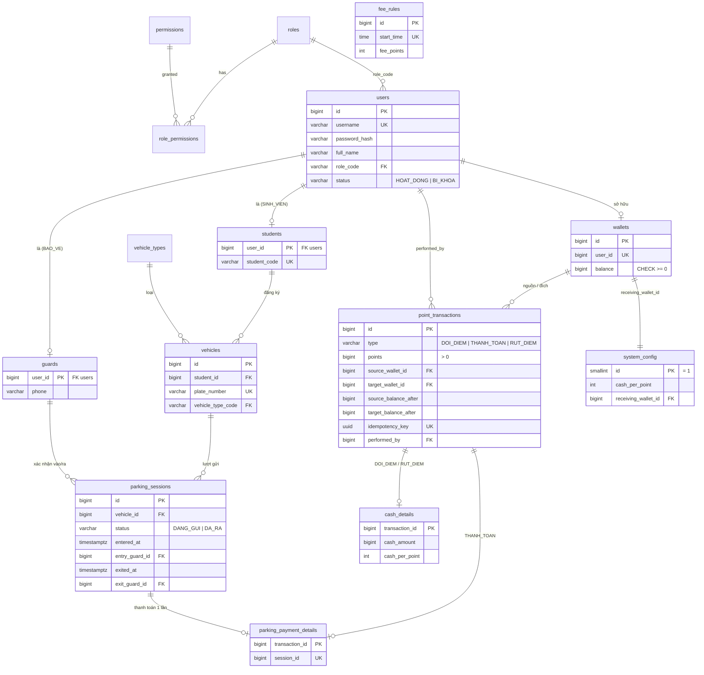

# Thiết kế CSDL — Hệ thống thanh toán phí gửi xe bằng điểm

MySQL 8.4 (LTS), quản lý bằng Flyway (`backend/src/main/resources/db/migration`).
Thời gian lưu theo UTC (`DATETIME(6)`), ứng dụng đổi sang giờ Việt Nam khi tính phí và hiển thị.

## 1. Sơ đồ ERD

## 2. Bảng ↔ lớp Java ↔ khái niệm OOP

| Bảng | Lớp domain | OOP thể hiện |
|---|---|---|
| `users` + `students` / `guards` | `User` (abstract) → `Student`, `Guard`, `Manager`, `Owner` | **Kế thừa**, **Trừu tượng hóa** (Class Table Inheritance) |
| `wallets` | `Wallet` | **Đóng gói**: `balance` chỉ đổi qua `credit()` / `debit()` |
| `point_transactions` + `cash_details` / `parking_payment_details` | `PointTransaction` (abstract sealed) → `CashDeposit`, `CashWithdrawal`, `ParkingPayment` | **Đa hình**: `changeFor(walletId)` |
| `fee_rules` | `FeePolicy` (interface) ← `TimeSlotFeePolicy` | **Trừu tượng hóa**, Strategy |
| `parking_sessions` | `ParkingSession` | **Đóng gói**: `close()` ghi giờ ra + bảo vệ cùng lúc |
| `roles`, `permissions`, `role_permissions` | (dữ liệu RBAC) | Quyền là dữ liệu, không hóa cứng |

## 3. Quy tắc nghiệp vụ ↔ ràng buộc CSDL

| Quy tắc | Ràng buộc |
|---|---|
| R01 điểm không âm | `ck_wallets_balance`, `ck_point_transactions_balances` |
| R05 mỗi xe tối đa 1 lượt mở | `uq_parking_sessions_open` trên cột sinh tự động `open_vehicle_id` (= `vehicle_id` khi `DANG_GUI`, `NULL` khi `DA_RA`) — cách làm "unique có điều kiện" trong MySQL |
| Một lượt gửi chỉ thanh toán 1 lần | `uq_payment_details_session` |
| Bấm xác nhận nhiều lần chỉ 1 giao dịch | `uq_point_transactions_idempotency` |
| R06/R09 nguồn/đích đúng theo loại giao dịch | `ck_point_transactions_shape` |
| R10 giao dịch không sửa/xóa | trigger `trg_*_no_update`, `trg_*_no_delete` (`SIGNAL SQLSTATE '45000'`) |
| R11 lưu tỷ lệ tại thời điểm giao dịch | `cash_details.cash_per_point` |
| R12, R13 đối soát | view `v_reconciliation` |
| R14 bảo vệ chỉ khóa, không xóa | `users.status` + FK từ `parking_sessions` (xóa sẽ bị chặn) |
| UNIQUE MSSV / username / biển số | `uq_students_code`, `uq_users_username`, `uq_vehicles_plate` |
| Bảo vệ không thể có MSSV | FK kép `(user_id, role_code)` + `ck_students_role` |

Tên ràng buộc được backend ánh xạ sang mã lỗi API (ví dụ `uq_vehicles_plate` → `PLATE_EXISTS`).

## 4. Tài khoản seed (chỉ để demo)

| Vai trò | Username | Mật khẩu |
|---|---|---|
| Quản lý | `quanly01` | `Quanly@123` |
| Chủ tài khoản | `chutk01` | `Chutk@123` |
