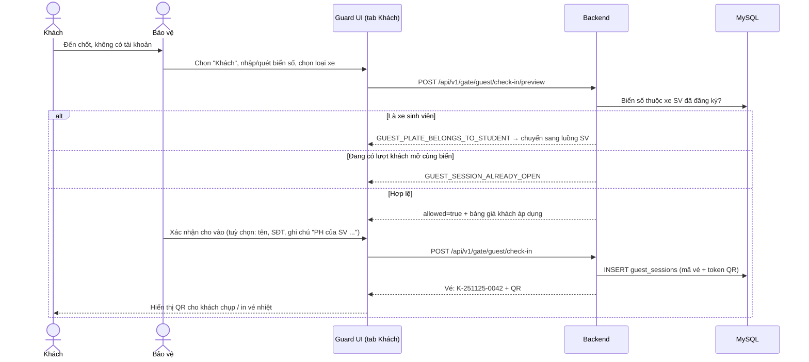
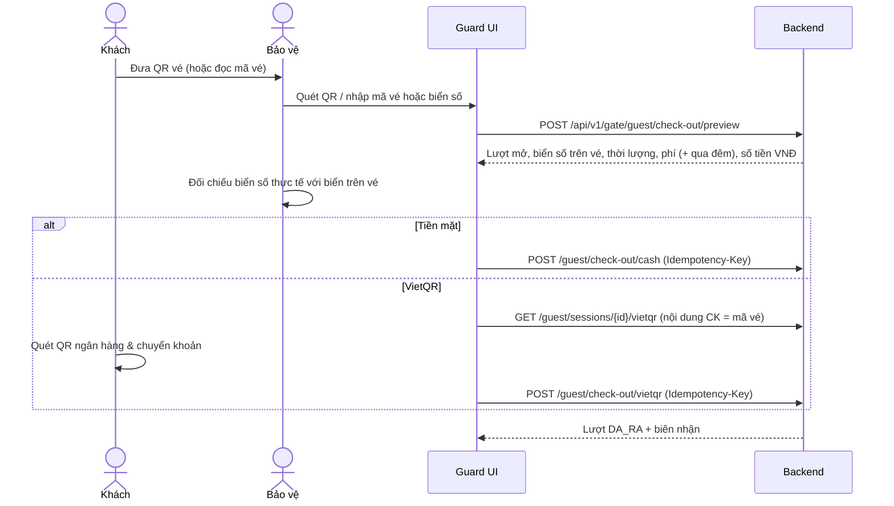
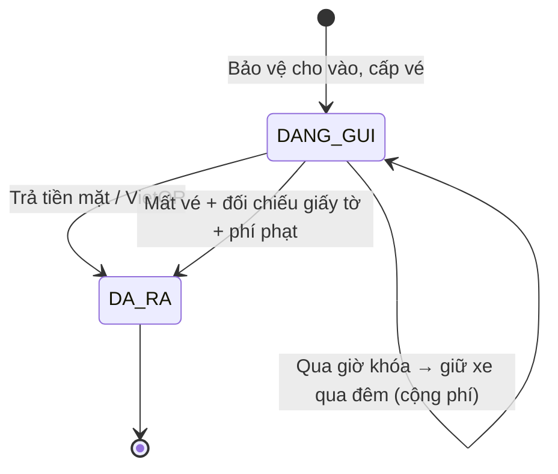
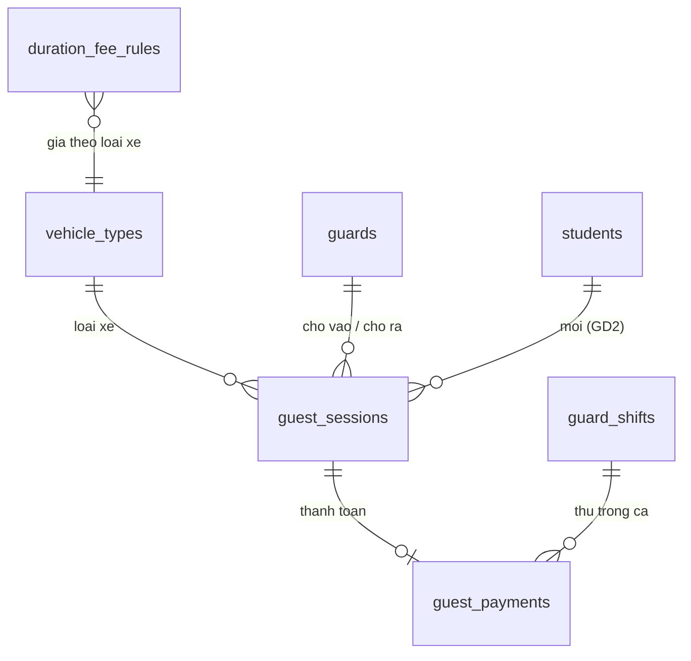

# Đề xuất tính năng: Gửi xe cho Khách / Phụ huynh (không phải sinh viên)

> Trạng thái: **Bản đề xuất (chưa triển khai)** · Ngày: 25/11/2026
> Phạm vi: backend (Spring Boot, kiến trúc hexagonal hiện có) + frontend (React) + migration Flyway mới.

---

## 1. Bối cảnh & vấn đề

Hiện tại toàn bộ luồng gửi xe được thiết kế cho **sinh viên có tài khoản**:

| Thành phần hiện có | Ràng buộc với sinh viên |
|---|---|
| `parking_sessions.vehicle_id` | `NOT NULL`, FK → `vehicles` → `students` |
| `CheckInUseCase` | Bắt buộc tìm được xe đã đăng ký (`PLATE_NOT_FOUND`), kiểm tra ví đủ điểm tối thiểu (R04) |
| `CheckOutByCashUseCase` / `PayParkingFeeByVietQrUseCase` | Tra chủ xe qua `VehicleOwnerDirectory`; VietQR ghi bút toán vào **ví sinh viên** để giữ bất biến R12 |
| `VehicleTypeDurationFeePolicy` | Tính giá theo `vehicleId` (xe đã đăng ký) |

→ Phụ huynh, khách mời, khách đến làm việc… **không có tài khoản, không có ví, không đăng ký xe** nên không thể gửi xe trong hệ thống. Bảo vệ phải ghi sổ tay ngoài, mất kiểm soát doanh thu và an ninh.

## 2. Mục tiêu

1. Bảo vệ cho **khách vãng lai** gửi/lấy xe ngay tại chốt, không cần tài khoản.
2. Khách nhận **vé điện tử (mã vé + QR)** làm bằng chứng lấy xe; có quy trình **mất vé**.
3. Thanh toán khi ra bằng **tiền mặt** hoặc **VietQR**, theo **bảng giá riêng cho khách** do Quản lý cấu hình.
4. Doanh thu khách được ghi nhận **append-only**, đi vào bảng tiền ca trực và báo cáo doanh thu chủ bãi.
5. **Không làm thay đổi** luồng, bất biến và dữ liệu của sinh viên (R04, R05, R12).

**Ngoài phạm vi (giai đoạn 1):** khách tự tạo tài khoản, vé tháng cho khách, đặt chỗ trước có trả tiền online.

## 3. Đối tượng & vai trò

| Vai trò | Việc làm được |
|---|---|
| **Khách / Phụ huynh** | Nhận vé tại chốt, (tuỳ chọn) mở link vé để xem giờ vào & phí tạm tính, trả tiền khi ra |
| **Bảo vệ** | Cho xe khách vào, cấp vé, cho xe ra, thu tiền / xác nhận VietQR, xử lý mất vé |
| **Quản lý** | Cấu hình giá khách, phí mất vé, bật/tắt tính năng, xem danh sách lượt khách |
| **Chủ bãi** | Xem doanh thu tách riêng "Sinh viên" và "Khách" |
| **Sinh viên** *(giai đoạn 2)* | Tạo **lời mời gửi xe** cho phụ huynh, có thể chọn **trả hộ bằng điểm ví** |

---

## 4. Luồng nghiệp vụ

### 4.1 Xe khách vào (BV01-K)



- **Xe đạp không có biển số:** cho phép `plate_number = NULL`, khi đó **mã vé là định danh duy nhất** của xe.
- Không kiểm tra ví (khách không có ví) → **trả sau khi ra**.

### 4.2 Xe khách ra (BV02-K)



- **Tự nhận diện vé khách:** ở `CheckOutPanel` / `QrScannerDialog` hiện có, nếu chuỗi quét được có tiền tố `PTIT-GUEST:` thì tự chuyển sang luồng khách — bảo vệ không cần chọn tab.
- Tái sử dụng **giờ khóa lấy xe** và **phí qua đêm** từ `ParkingPolicyConfig` như sinh viên (`CHECKOUT_CURFEW`).

### 4.3 Khách mất vé

1. Bảo vệ tìm lượt theo **biển số** → chọn "Khách mất vé".
2. Bắt buộc đối chiếu **giấy đăng ký xe / CCCD**, nhập **4 số cuối** giấy tờ (không lưu đầy đủ để tránh lộ dữ liệu cá nhân).
3. Phí = phí gửi + **phí mất vé** (Quản lý cấu hình, ví dụ 20.000đ).
4. Hệ thống **tự tạo sự cố** loại `MAT_VE` — loại **mới**, cần thêm vào enum `IncidentType` (hiện có `XE_GUI_QUA_LAU`, `XE_CHUA_DANG_KY`, `XE_HU_HONG`, `KHAC`) và ràng buộc `ck_incidents_type` trong V031; tạo qua `ReportIncidentUseCase` hiện có → Quản lý nhận chuông thông báo + email (`IncidentChanged` → `IncidentEmailNotificationListener` đã có).
5. Xe đạp không biển mất vé → không cho tự xử lý tại chốt, chuyển Quản lý duyệt.

### 4.4 Vòng đời một lượt khách



### 4.5 (Giai đoạn 2) Sinh viên mời phụ huynh

- Sinh viên vào trang của mình → "Mời người thân gửi xe": nhập biển số, ngày đến, chọn **"Trả hộ bằng điểm của tôi"**.
- Khi phụ huynh vào, bảo vệ thấy badge **"Khách mời của SV Nguyễn Văn A"**.
- Khi ra: nếu chọn trả hộ → trừ điểm ví SV qua `ParkingPayment` (giữ nguyên sổ cái R12); không đủ điểm → khách trả tiền mặt/VietQR như thường.
- Sinh viên nhận thông báo "Người thân của bạn đã lấy xe, trừ X điểm".

---

## 5. Quy tắc nghiệp vụ mới

| Mã | Quy tắc |
|---|---|
| **RK01** | Biển số đã đăng ký cho xe sinh viên (`vehicles.plate_number`) **không được** gửi theo luồng khách → bảo vệ dùng luồng sinh viên. |
| **RK02** | Mỗi biển số tối đa **một** lượt khách đang mở (giống R05, dùng cột sinh tự động + `UNIQUE`). |
| **RK03** | Mỗi lượt khách có **mã vé** dễ đọc (`K-YYMMDD-NNNN`) và **token QR ngẫu nhiên 128-bit**; chỉ token mới mở được link vé công khai. |
| **RK04** | Số tiền do **backend tính** từ bảng giá khách × tỷ lệ quy đổi; bảo vệ **không nhập/sửa** số tiền (giống Mục 3.8). |
| **RK05** | Khoản thu khách là **append-only** (trigger chặn `UPDATE/DELETE` như `gate_cash_collections`). |
| **RK06** | Tiền khách **không** đi vào ví điểm và **không** ghi `point_transactions` (giữ R12), trừ trường hợp SV trả hộ bằng điểm (GĐ2). |
| **RK07** | Chỉ khoản **tiền mặt** được cộng vào tiền ca của bảo vệ; VietQR tính vào doanh thu nhưng không vào két. |
| **RK08** | Mất vé: bắt buộc đối chiếu giấy tờ + thu phí mất vé + tạo sự cố `MAT_VE`. |
| **RK09** | Dữ liệu cá nhân của khách (tên, SĐT) là **tuỳ chọn**; tự động ẩn danh sau 90 ngày. |

---

## 6. Thiết kế dữ liệu — migration `V031__guest_parking.sql`

> `V030` đang được dùng bởi `V030__student_social_accounts.sql`, nên migration mới là **V031**.



### 6.1 Bảng giá: thêm đối tượng áp dụng vào `duration_fee_rules`

```sql
ALTER TABLE duration_fee_rules
    ADD COLUMN customer_type VARCHAR(20) NOT NULL DEFAULT 'SINH_VIEN' FIRST,
    DROP PRIMARY KEY,
    ADD PRIMARY KEY (customer_type, vehicle_type_code, up_to_minutes),
    ADD CONSTRAINT ck_duration_fee_customer CHECK (customer_type IN ('SINH_VIEN', 'KHACH'));

-- Giá khách mặc định (đơn vị điểm, quy đổi VNĐ theo tỷ lệ hiện hành) — Quản lý chỉnh được
INSERT INTO duration_fee_rules (customer_type, vehicle_type_code, up_to_minutes, fee_points) VALUES
    ('KHACH', 'XE_MAY',      120,  5000), ('KHACH', 'XE_MAY',      360,  8000), ('KHACH', 'XE_MAY',      1440, 12000),
    ('KHACH', 'XE_MAY_DIEN', 120,  4000), ('KHACH', 'XE_MAY_DIEN', 360,  6000), ('KHACH', 'XE_MAY_DIEN', 1440, 10000),
    ('KHACH', 'XE_DAP',      120,  2000), ('KHACH', 'XE_DAP',      360,  3000), ('KHACH', 'XE_DAP',      1440,  5000);
```

Ưu điểm: tái sử dụng nguyên `FeeCatalogTab`, `ManageFeeCatalogUseCase`, `DurationFeePolicy`; chỉ thêm một chiều lọc.

### 6.2 Bảng `guest_sessions`

```sql
CREATE TABLE guest_sessions (
    id                BIGINT       NOT NULL AUTO_INCREMENT PRIMARY KEY,
    ticket_code       VARCHAR(20)  NOT NULL,                 -- K-251125-0042 (in trên vé, đọc cho nhau)
    ticket_token      CHAR(32) CHARACTER SET ascii NOT NULL, -- ngẫu nhiên, nằm trong QR & link vé
    plate_number      VARCHAR(20)  NULL,                     -- NULL với xe đạp không biển
    vehicle_type_code VARCHAR(20)  NOT NULL,
    guest_name        VARCHAR(100) NULL,
    guest_phone       VARCHAR(15)  NULL,
    note              VARCHAR(255) NULL,                     -- "Phụ huynh SV B21DCCN001"
    host_student_id   BIGINT       NULL,                     -- GĐ2: SV mời
    status            VARCHAR(20)  NOT NULL DEFAULT 'DANG_GUI',
    lost_ticket       BOOLEAN      NOT NULL DEFAULT FALSE,
    entered_at        DATETIME(6)  NOT NULL DEFAULT CURRENT_TIMESTAMP(6),
    entry_guard_id    BIGINT       NOT NULL,
    exited_at         DATETIME(6)  NULL,
    exit_guard_id     BIGINT       NULL,
    open_plate        VARCHAR(20) GENERATED ALWAYS AS (CASE WHEN status = 'DANG_GUI' THEN plate_number END) STORED,

    CONSTRAINT uq_guest_ticket_code  UNIQUE (ticket_code),
    CONSTRAINT uq_guest_ticket_token UNIQUE (ticket_token),
    CONSTRAINT uq_guest_open_plate   UNIQUE (open_plate),                       -- RK02
    CONSTRAINT fk_guest_vehicle_type FOREIGN KEY (vehicle_type_code) REFERENCES vehicle_types (code),
    CONSTRAINT fk_guest_entry_guard  FOREIGN KEY (entry_guard_id)    REFERENCES guards (user_id),
    CONSTRAINT fk_guest_exit_guard   FOREIGN KEY (exit_guard_id)     REFERENCES guards (user_id),
    CONSTRAINT fk_guest_host_student FOREIGN KEY (host_student_id)   REFERENCES students (user_id),
    CONSTRAINT ck_guest_status CHECK (status IN ('DANG_GUI', 'DA_RA')),
    CONSTRAINT ck_guest_state CHECK (
        (status = 'DANG_GUI' AND exited_at IS NULL     AND exit_guard_id IS NULL) OR
        (status = 'DA_RA'    AND exited_at IS NOT NULL AND exit_guard_id IS NOT NULL)),
    CONSTRAINT ck_guest_time CHECK (exited_at IS NULL OR exited_at >= entered_at)
);
CREATE INDEX ix_guest_sessions_status_time ON guest_sessions (status, entered_at DESC);
```

### 6.3 Bảng `guest_payments` (append-only)

```sql
CREATE TABLE guest_payments (
    id               BIGINT      NOT NULL AUTO_INCREMENT PRIMARY KEY,
    guest_session_id BIGINT      NOT NULL,
    guard_id         BIGINT      NOT NULL,
    shift_id         BIGINT      NULL,
    method           VARCHAR(20) NOT NULL,          -- TIEN_MAT | VIETQR | DIEM_SV (GĐ2)
    fee_points       BIGINT      NOT NULL,          -- phí theo bảng giá (điểm)
    amount           BIGINT      NOT NULL,          -- VNĐ thực thu = (fee_points × tỷ lệ) + phí mất vé
    overnight        BOOLEAN     NOT NULL DEFAULT FALSE,
    lost_ticket_fee  BIGINT      NOT NULL DEFAULT 0,
    idempotency_key  CHAR(36) CHARACTER SET ascii NOT NULL,
    paid_at          DATETIME(6) NOT NULL DEFAULT CURRENT_TIMESTAMP(6),

    CONSTRAINT uq_guest_payment_session     UNIQUE (guest_session_id),
    CONSTRAINT uq_guest_payment_idempotency UNIQUE (idempotency_key),
    CONSTRAINT fk_guest_payment_session FOREIGN KEY (guest_session_id) REFERENCES guest_sessions (id),
    CONSTRAINT fk_guest_payment_guard   FOREIGN KEY (guard_id)          REFERENCES guards (user_id),
    CONSTRAINT fk_guest_payment_shift   FOREIGN KEY (shift_id)          REFERENCES guard_shifts (id),
    CONSTRAINT ck_guest_payment_method  CHECK (method IN ('TIEN_MAT', 'VIETQR', 'DIEM_SV')),
    CONSTRAINT ck_guest_payment_amount  CHECK (amount > 0)
);
-- + 2 trigger chặn UPDATE / DELETE giống trg_gate_cash_no_update / trg_gate_cash_no_delete
```

### 6.4 Cấu hình `system_config`

```sql
ALTER TABLE system_config
    ADD COLUMN guest_parking_enabled BOOLEAN NOT NULL DEFAULT TRUE,
    ADD COLUMN lost_ticket_fee_vnd   INT     NOT NULL DEFAULT 20000,
    ADD CONSTRAINT ck_system_config_lost_ticket CHECK (lost_ticket_fee_vnd >= 0);
```

### 6.5 Vì sao **tách bảng** thay vì nới `parking_sessions`?

| Phương án | Ưu | Nhược |
|---|---|---|
| **A. Bảng riêng `guest_sessions` (đề xuất)** | Không đụng FK/CHECK/R05 của sinh viên; mọi query `JOIN vehicles` cũ giữ nguyên đúng; domain rõ ràng (OOP: aggregate riêng) | Thống kê tổng phải `UNION` 2 nguồn |
| B. `parking_sessions.vehicle_id` cho phép NULL + cột `guest_*` | Một bảng duy nhất | Phải sửa ~10 câu SQL đang `JOIN vehicles` (`GateActivityJdbcAdapter`, `GateCashJdbcAdapter`, `StudentSessionJdbcAdapter`, `ComplaintDirectoryJdbcAdapter`…), dễ lọt dữ liệu khách vào màn hình sinh viên, rủi ro hồi quy cao |

---

## 7. Thiết kế backend (module mới `com.ptit.parking.guest`)

Giữ đúng phong cách hexagonal của dự án (`domain` / `application` / `infrastructure` / `presentation` / `configuration`).

```
guest/
├── domain/
│   ├── GuestSession.java          // aggregate: open(...), close(...), markLostTicket()
│   ├── TicketCode.java            // value object K-YYMMDD-NNNN, validate & parse
│   ├── TicketToken.java           // value object 128-bit, sinh bằng SecureRandom
│   ├── GuestPayment.java          // append-only, factory create(...)
│   └── GuestPaymentMethod.java    // TIEN_MAT, VIETQR, DIEM_SV
├── application/
│   ├── port/out/
│   │   ├── GuestSessionRepository.java
│   │   ├── GuestPaymentRepository.java
│   │   ├── StudentPlateLookup.java   // RK01: biển số có thuộc SV không
│   │   └── GuestTariff.java          // lấy FeeRule theo (KHACH, vehicleType)
│   └── usecase/
│       ├── PreviewGuestCheckInUseCase.java
│       ├── GuestCheckInUseCase.java
│       ├── PreviewGuestCheckOutUseCase.java
│       ├── GuestCheckOutByCashUseCase.java
│       ├── GuestCheckOutByVietQrUseCase.java
│       ├── GuestLostTicketCheckOutUseCase.java
│       ├── ViewGuestTicketUseCase.java      // link công khai theo token
│       └── ListGuestSessionsUseCase.java    // cho Quản lý
├── infrastructure/persistence/  (GuestSessionJdbcAdapter, GuestPaymentJdbcAdapter, ...)
├── presentation/web/            (GuestGateController, PublicGuestTicketController, ManagerGuestController)
└── configuration/GuestUseCaseConfig.java
```

**Tái sử dụng thay vì viết lại:**

- `DurationFeePolicy` (domain) để tính phí theo các mốc giá khách.
- `ParkingPolicyConfig` cho giờ khóa & phí qua đêm.
- `ExchangeRateRepository` để quy đổi điểm → VNĐ (giống `CheckOutByCashUseCase`).
- `OpenShiftLookup` để gắn khoản thu tiền mặt vào ca trực.
- `VietQrGenerator` để sinh QR chuyển khoản với nội dung = mã vé.
- `ReportIncidentUseCase` + `IncidentChanged` cho trường hợp mất vé.
- `EventPublisher`: phát `GuestCheckedIn` / `GuestCheckedOut` cho thống kê và (GĐ2) thông báo SV mời.

**Mã lỗi mới (`ErrorCode`):** `GUEST_PARKING_DISABLED`, `GUEST_PLATE_BELONGS_TO_STUDENT`, `GUEST_SESSION_ALREADY_OPEN`, `GUEST_TICKET_NOT_FOUND`, `GUEST_TICKET_PLATE_MISMATCH`, `GUEST_LOST_TICKET_REQUIRES_MANAGER`.

### 7.1 API đề xuất

| Method | Endpoint | Vai trò | Mô tả |
|---|---|---|---|
| POST | `/api/v1/gate/guest/check-in/preview` | Bảo vệ | Kiểm tra RK01/RK02, trả bảng giá áp dụng |
| POST | `/api/v1/gate/guest/check-in` | Bảo vệ | Tạo lượt, trả `ticketCode`, `ticketToken`, `qrPayload` |
| POST | `/api/v1/gate/guest/check-out/preview` | Bảo vệ | Body: `ticketToken` \| `ticketCode` \| `plateNumber` → phí, thời lượng |
| POST | `/api/v1/gate/guest/check-out/cash` | Bảo vệ | `Idempotency-Key` header |
| GET  | `/api/v1/gate/guest/sessions/{id}/vietqr` | Bảo vệ | QR chuyển khoản số tiền chính xác |
| POST | `/api/v1/gate/guest/check-out/vietqr` | Bảo vệ | Xác nhận đã nhận chuyển khoản |
| POST | `/api/v1/gate/guest/check-out/lost-ticket` | Bảo vệ | `plateNumber`, `documentLast4` |
| GET  | `/api/v1/public/guest-tickets/{token}` | Công khai | Giờ vào, thời lượng, phí tạm tính (rate-limit bằng `RateLimitFilter`) |
| GET  | `/api/v1/manager/guest-sessions` | Quản lý | Lọc theo ngày/trạng thái/biển số |
| PUT  | `/api/v1/manager/guest-config` | Quản lý | Bật/tắt, phí mất vé |

Bảng giá khách dùng lại API của tab "Giá vé lượt", thêm tham số `customerType=KHACH`.

---

## 8. Thiết kế frontend

### Bảo vệ (`features/guard`)
- **`CheckInPanel`**: thêm công tắc **Sinh viên | Khách**. Khi tra biển số SV trả `PLATE_NOT_FOUND`, hiện nút nhanh **"Gửi theo diện khách"** (đỡ thao tác).
- **`GuestCheckInForm`** (mới): biển số (hoặc tick "Xe đạp không biển"), loại xe, tên/SĐT/ghi chú tuỳ chọn.
- **`GuestTicketCard`** (mới): mã vé chữ lớn + QR, nút **In vé** (CSS `@media print` khổ 58mm cho máy in nhiệt) và gợi ý "Khách chụp ảnh màn hình".
- **`CheckOutPanel`**: nhận QR `PTIT-GUEST:<token>` → tự chuyển luồng khách; hiển thị **biển trên vé to, nổi bật** để đối chiếu; 2 nút **Thu tiền mặt** / **VietQR** (tái sử dụng `VietQrPaymentCard`); nút phụ **Khách mất vé**.
- **`ParkedVehiclesTab`**: gộp danh sách, badge **"Khách"** màu khác; bộ lọc Tất cả / SV / Khách.
- **Bảng tiền ca (`ShiftTab`)**: thêm dòng "Tiền mặt từ khách".

### Quản lý (`features/manager`)
- **`FeeCatalogTab`**: thêm nhóm tab **Sinh viên | Khách** phía trên tab loại xe.
- **`GuestSessionsTab`** (mới): danh sách lượt khách, tổng thu theo ngày, xuất CSV.
- Cấu hình: bật/tắt gửi xe khách, phí mất vé.

### Chủ bãi (`features/owner`)
- **`RevenueCard`**: tách cột **Doanh thu SV (điểm)** và **Doanh thu khách (tiền mặt / VietQR)**.

### Trang công khai
- Route `/ve/:token`: khách mở từ QR (qua HTTPS tunnel/điện thoại) để xem giờ vào, thời gian đã gửi, **phí tạm tính**, giờ khóa lấy xe. Không cần đăng nhập.

---

## 9. Bảo mật & chống gian lận

- **Lấy nhầm/lấy trộm xe:** check-out bắt buộc khớp vé ↔ lượt; giao diện hiển thị biển số trên vé để bảo vệ đối chiếu bằng mắt; mất vé phải qua giấy tờ + sự cố.
- **Đoán link vé:** token 128-bit ngẫu nhiên, không lộ ID tự tăng; endpoint công khai chỉ đọc + giới hạn tần suất.
- **Bảo vệ sửa tiền:** số tiền luôn do backend tính (RK04); khoản thu append-only (RK05); idempotency-key chống bấm 2 lần.
- **Lách luồng sinh viên:** RK01 chặn xe SV đi luồng khách (tránh né kiểm tra ví R04).
- **Dữ liệu cá nhân:** tên/SĐT tuỳ chọn, chỉ lưu 4 số cuối giấy tờ, job ẩn danh sau 90 ngày.

## 10. Tình huống biên cần xử lý

| Tình huống | Cách xử lý |
|---|---|
| Khách vào rồi sau đó đăng ký thành SV với cùng biển số | Lượt khách đang mở vẫn đóng theo luồng khách; lần sau mới tính là SV |
| Hai bảo vệ cùng cho một biển khách vào | `UNIQUE(open_plate)` → request sau nhận `GUEST_SESSION_ALREADY_OPEN` |
| Mất mạng giữa lúc thu tiền | Gửi lại cùng `Idempotency-Key` → trả lại khoản thu cũ, không thu 2 lần |
| Quá giờ khóa (22:00) | Không cho ra, sáng hôm sau tính thêm phí qua đêm như SV |
| Xe đạp không biển mất vé | Không xử lý tại chốt → `GUEST_LOST_TICKET_REQUIRES_MANAGER` |
| Quản lý tắt tính năng khi còn xe khách trong bãi | Chặn **vào**, vẫn cho **ra** bình thường |

## 11. Kế hoạch kiểm thử

- **Unit (domain):** `GuestSession.open/close`, `TicketCode` parse/format, tính phí khách theo mốc + qua đêm + phí mất vé.
- **Use case:** RK01 (biển SV bị chặn), RK02 (trùng lượt mở), idempotency tiền mặt/VietQR, giờ khóa, mất vé tạo sự cố.
- **Integration (MySQL/Testcontainers như hiện có):** CHECK/UNIQUE/trigger append-only của `guest_payments`.
- **Frontend (Vitest + mock API):** chuyển luồng khi quét QR khách, hiển thị vé, tách doanh thu.
- **Thủ công trên Docker:** điện thoại quét QR vé qua HTTPS tunnel, in vé, thu tiền mặt → kiểm tra bảng tiền ca.

## 12. Lộ trình triển khai

| Giai đoạn | Nội dung | Ước lượng |
|---|---|---|
| **GĐ1 – MVP** | V031, module `guest` (vào/ra/tiền mặt), tab Khách ở chốt, vé QR, giá khách trong `FeeCatalogTab` | 3–4 ngày |
| **GĐ1.5** | VietQR cho khách, mất vé + sự cố, tiền ca & doanh thu tách riêng, trang `/ve/:token` | 2–3 ngày |
| **GĐ2** | SV mời phụ huynh + trả hộ bằng điểm, thông báo cho SV, báo cáo/CSV, ẩn danh dữ liệu | 3–4 ngày |

---

## 13. Câu hỏi cần chốt

1. **Mức giá khách** mặc định: dùng bảng gợi ý ở §6.1 hay muốn mức khác (vd. đồng giá 5.000đ/lượt)?
2. **Vé giấy** (có máy in nhiệt ở chốt) hay chỉ **vé điện tử** cho khách chụp màn hình?
3. Có cần **GĐ2 – sinh viên mời & trả hộ bằng điểm** ngay trong đợt này không?
4. Có cần **giới hạn số chỗ** dành cho khách (vd. tối đa 50 xe khách cùng lúc) không?
5. Có bắt buộc thu **SĐT khách** không, hay để tuỳ chọn như đề xuất?
